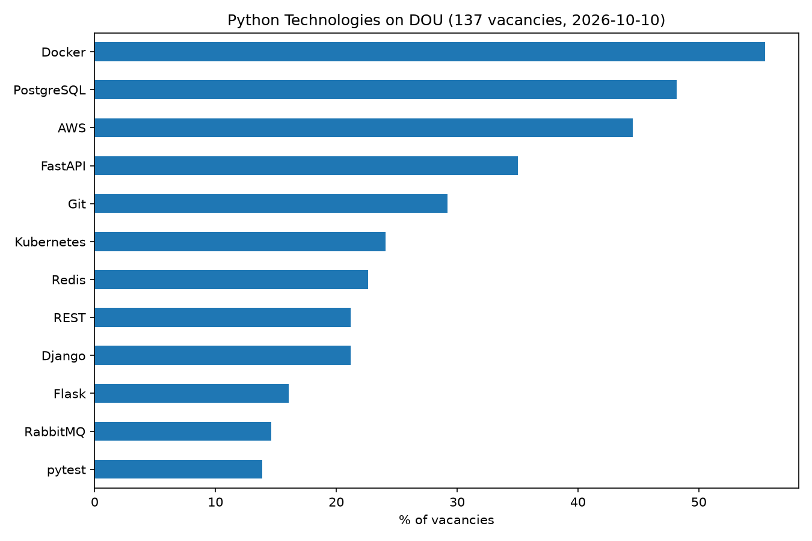
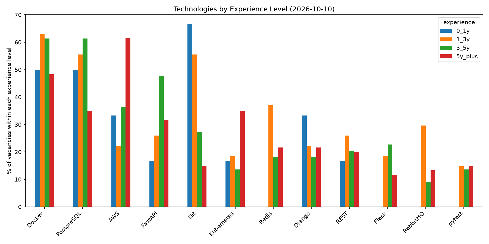

# Python Technologies Statistics

An asynchronous Python vacancy scraper for [DOU](https://jobs.dou.ua/) that collects Python job postings, analyzes technology mentions, and generates visual reports by experience level.

The project helps explore which technologies appear most frequently in Python job descriptions and how these requirements may change over time.

## Features

* **Asynchronous scraping** — collects vacancy data using `httpx` and `asyncio`.
* **Resilient requests** — retries timeouts, `429` and `5xx` responses with exponential backoff, and keeps going when a single vacancy fails.
* **Multiple data sources** — retrieves vacancy links from DOU RSS feeds and the vacancy listing page, including its `xhr-load` endpoint.
* **Vacancy parsing** — extracts job titles, publication dates, locations, descriptions, and experience categories.
* **Technology analysis** — identifies technology mentions using regular expressions.
* **Experience-level comparison** — analyzes vacancies across different experience ranges.
* **Data visualization** — generates charts with Matplotlib.
* **Historical tracking** — stores technology statistics by collection date to support trend analysis.
* **Automated tests** — unit tests for URL normalization, link extraction, retries, and vacancy parsing.

## Technologies Used

* Python
* `asyncio`
* `httpx`
* Beautiful Soup
* lxml
* pandas
* Matplotlib
* pytest
* Regular expressions
* JSONL and CSV

## Project Structure

```text
python-tech-stats/
├── .github/
│   └── workflows/
│       └── ci.yml
├── analysis/
│   ├── __init__.py
│   └── analyze.py
├── charts/
│   ├── by_experience_2026-10-10.png
│   └── overall_2026-10-10.png
├── data/
│   ├── raw/
│   │   ├── .gitkeep
│   │   └── vacancies_2026-10-10.jsonl
│   └── history.csv
├── scraper/
│   ├── __init__.py
│   └── scrape.py
├── tests/
│   ├── test_analyze.py
│   ├── test_config.py
│   └── test_scrape.py
├── .gitignore
├── config.py
├── pyproject.toml
├── requirements.txt
└── README.md
```

### Main Components

* `.github/workflows/ci.yml` — GitHub Actions workflow for automated project checks.
* `analysis/analyze.py` — analyzes collected vacancy data, generates charts, and updates historical statistics.
* `charts/` — contains generated technology statistics visualizations.
* `data/raw/` — stores raw vacancy data in JSONL format.
* `data/history.csv` — stores historical technology counts by collection date.
* `scraper/scrape.py` — asynchronously collects vacancy links and extracts vacancy information from DOU.
* `tests/test_analyze.py` — tests analysis functionality.
* `tests/test_config.py` — tests configuration and technology patterns.
* `tests/test_scrape.py` — tests scraping functionality, including URL handling, link extraction, retries, and parsing.
* `config.py` — contains scraping settings, experience categories, and technology patterns.
* `pyproject.toml` — contains project tooling configuration, including code formatting and linting settings.
* `requirements.txt` — lists project dependencies.
* `.gitignore` — specifies files and directories Git should ignore.


## How It Works

1. **Collect vacancy links.** The scraper retrieves Python vacancy links for several experience categories using DOU RSS feeds and the vacancy listing page.
2. **Load vacancy details.** It downloads vacancy pages and extracts relevant information, including titles, locations, dates, and descriptions.
3. **Save raw data.** Each collection run saves vacancy records to a date-based JSONL file. Every record has a `scraped_at` field with the collection time in UTC.
4. **Analyze descriptions.** The analysis module searches vacancy descriptions for technology keywords using regular expressions configured in `config.py`.
5. **Generate visualizations.** Matplotlib produces an overall technology overview and a comparison by experience level.
6. **Track changes over time.** Technology counts are appended to `data/history.csv` for historical analysis.

A vacancy may match multiple experience categories. In experience-specific statistics, it can be counted in each matching category, while the overall statistics count each unique vacancy once.

## Tracked Technologies

The list is configurable and currently includes:

* **Frameworks:** Django, Flask, FastAPI
* **Databases:** PostgreSQL, MySQL
* **Infrastructure and cloud:** Docker, Kubernetes, AWS
* **Task queues and messaging:** Celery, RabbitMQ, Kafka
* **Caching and asynchronous programming:** Redis, asyncio
* **Data processing:** Pandas
* **Database tools:** SQLAlchemy
* **Testing:** pytest
* **Development tools and concepts:** Git, REST APIs

Technology patterns can be modified or extended in `config.py`.

## Installation

Python 3.10 or newer is recommended.

Clone the repository and enter the project directory:

```bash
git clone https://github.com/Sardor-Tozhiyev/python-tech-stats.git
cd python-tech-stats
```

Create and activate a virtual environment:

```bash
python3 -m venv .venv
source .venv/bin/activate
```

Install the dependencies:

```bash
pip install -r requirements.txt
```

## Running the Project

Run all commands from the project root, using `python -m`, so that imports resolve correctly.

Run the scraper to collect the latest vacancy data:

```bash
python -m scraper.scrape
```

Run the analysis to generate visualizations and update historical statistics:

```bash
python -m analysis.analyze
```

The analysis uses the collected data files in `data/raw/`. Run the scraper first if no raw data is available.

## Testing

Install pytest and run the test suite from the project root:

```bash
pip install pytest
python -m pytest
```

The tests use mocked HTTP responses, so they do not contact DOU and finish in about a second.

## Results and Visualizations

The project generates visual reports based on the latest collected vacancy data.

* **Overall technology statistics** — shows which tracked technologies are mentioned most frequently across unique vacancies.
* **Technology statistics by experience level** — compares technology mentions across experience categories.
* **Technology trends** — tracks changes in technology mentions across collection dates, when sufficient historical data is available.

Generated charts are stored in `charts/`. The results represent a snapshot of the vacancies collected at a particular time and may change with subsequent runs.

### Overall Technology Statistics



### Technology Statistics by Experience Level



### Sample Vacancy Data

A sample of collected vacancy data from October 10, 2026, is available in JSONL format:

[`data/raw/vacancies_2026-10-10.jsonl`](data/raw/vacancies_2026-10-10.jsonl)

Each line in the file represents a vacancy record collected by the scraper.

Historical counts are stored in `data/history.csv` to support trend analysis. Meaningful comparisons require data collected on multiple dates.

## Limitations

* **Keyword-based analysis:** a technology mention does not necessarily mean it is a mandatory job requirement.
* **Data coverage:** results reflect the vacancies discovered by the scraper and are not a complete representation of the entire Python job market.
* **Changing data:** vacancy listings and technology frequencies may change between collection runs.
* **Historical trends:** meaningful trend comparisons require data collected on multiple dates.
* **Website availability and layout:** requests may occasionally fail or be restricted by the website. The scraper uses request delays, retries failed requests with exponential backoff, and logs errors. It relies on the current DOU HTML structure, so a layout change can reduce the amount of collected data; the scraper logs an error when too few vacancies are parsed.

## Possible Improvements

* Schedule regular scraping runs.
* Add more technologies and improve keyword matching, including negative mentions such as "no Docker experience required".
* Compare technology demand across dates and experience levels.
* Add salary analysis when reliable salary data is available.
* Expand test coverage with additional edge cases and fixtures based on real DOU pages.
